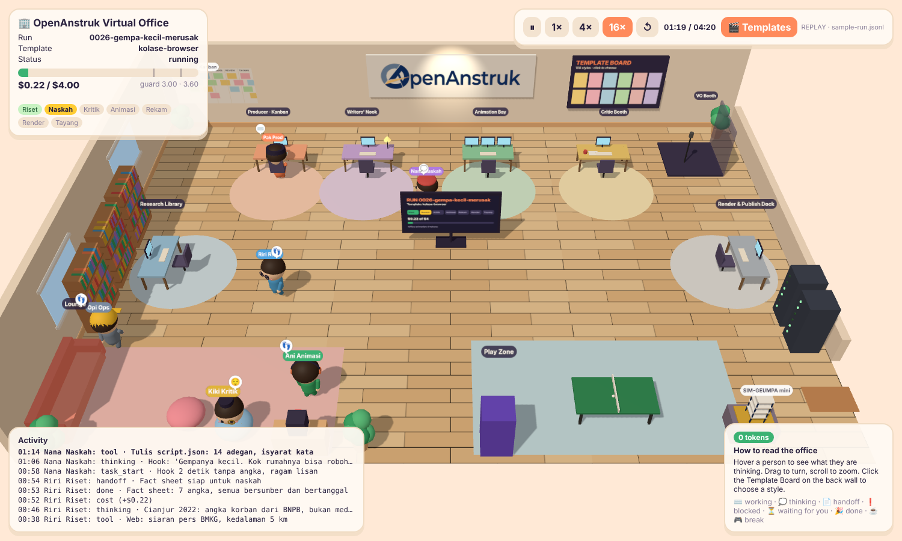

# OpenAnstruk Virtual Office

A cute 3D office where six AI staff make reels for @openanstruk and Aina. The office only reads an event log, so watching it costs **0 tokens**.



## Where it goes
Put this folder in `video-in-motion/office/` (shared tools live at the root there). The logo comes from OpenAnstruk-Studio `marketing/logo/`; the office never publishes anything from `marketing/`.

## Watch the sample run (replay)
```
cd office
npx serve .            # or: python -m http.server 8765
```
Open `http://localhost:3000/` (or `:8765`). It replays `data/sample-run.jsonl`: reel 0026 "Gempa kecil tapi merusak" for the 20 Nov slot, $1.78 of $4.

- Drag to turn, scroll to zoom, hover a person to see their thought, model and spend.
- Click the **Template Board** on the back wall (or the 🎬 button) to pick a template.
- Speed 1×, 4×, 16×; ↺ restarts.

## Run the pipeline and watch it live
```
node orchestrator/run.mjs --topic "Gempa kecil tapi merusak" --slot 2026-11-20 --template kolase-browser --pace 3
```
Open `index.html?live=1` at the same time. Engines:

| `--engine` | What happens | Cost |
|---|---|---|
| `dry` (default) | Simulated steps with realistic token sizes | free |
| `claude-cli` | Each seat runs as `claude -p` in `--repo`, with its agent file and model. Works on a subscription or an API key | real |
| `api` | Text-only steps through the Messages API (`ANTHROPIC_API_KEY`) | real |

Budget guard: wrap-up at $3.00, stop at $3.60, cap $4.00. Each step's turn limit shrinks to fit what is left.

## Agent files
Copy `agents/office-*.md` into the repo's `.claude/agents/`. They point to your existing skills and critics (`naskah-critic`, `prose-critic`, `slide-critic`, `attention-check`) instead of copying them.

## Files
| Path | What |
|---|---|
| `index.html`, `js/world.js`, `js/staff.js`, `js/main.js` | The office (three.js r160 from Studio explorations, in `vendor/`) |
| `data/staff.json` | Seats, names, colours, models |
| `data/sample-run.jsonl` | Sample event log |
| `docs/EVENTS.md` | Event format |
| `orchestrator/run.mjs` | Producer pipeline + budget guard + event writer |
| `template-picker.html`, `templates.json` | Template Board (9 house templates + 99 lemo-opuscar styles) |
